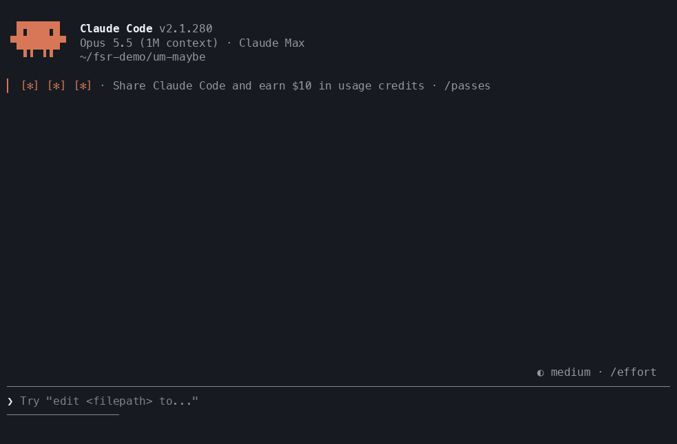
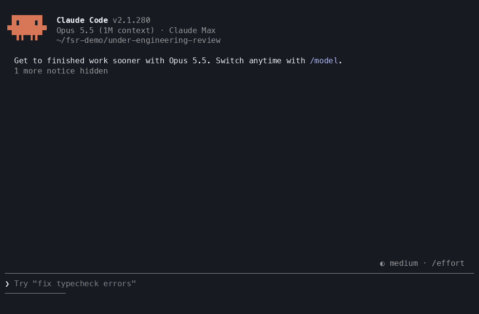
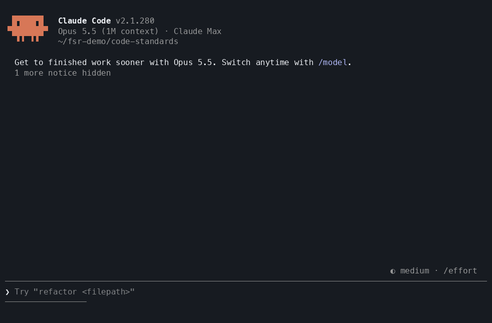

<p align="center">
  
</p>

<p align="center">
  <a href="#install"></a>
  <a href="#the-skills"></a>
  <a href="benchmarks/"></a>
  <a href="LICENSE"></a>
</p>

<p align="center">
  <a href="#install">Install</a> ·
  <a href="#the-skills">Skills</a> ·
  <a href="#benchmarks">Benchmarks</a> ·
  <a href="#how-they-fit-together">How they fit together</a> ·
  <a href="demo/">Demo project</a>
</p>

---

**Fullstack Rocks skills** are open-source [agent skills](https://docs.claude.com/en/docs/agents-and-tools/agent-skills/overview) for code a human can still read, trace and maintain after the agent is gone. They work with Claude Code, Codex, Cursor and any other agent that loads `SKILL.md` skills.

Coding agents over-build. They add validation nobody asked for, retries, config, abstraction layers and registries. Each piece looks reasonable alone, but together they leave code that is deep, hard to trace and expensive to maintain. These skills give the agent:
- a **checkpoint before it writes code**
- **hard, measured limits** while it writes
- **reviews** grounded in your project's own rules
- a way to **learn** what your team rejects

Anything the agent can't justify comes back to you as a decision.

<table>
<tr>
<th width="50%">❌ Without</th>
<th width="50%">✅ With</th>
</tr>
<tr>
<td valign="top">

- "Add rate limiting" arrives as a new module with a `RateLimiter` class, a thread lock, a decorator factory and a new HTTP-header contract
- Call chains run deep through string-keyed handler dicts and `getattr`
- Reviews hand out advice you can't trace to a rule
- You correct the same pattern in every PR

</td>
<td valign="top">

- The same request arrives as one 7-line function, after a single checkpoint message that says what was cut and why
- Depth, complexity and size are measured by parsers, in any language
- Every review finding cites a linter rule, a `cs-*` rule or a `std-*` standard
- "We never do X" becomes a tested rule, and the agent proposes the bypasses up front

</td>
</tr>
</table>

## The skills

| Skill | What it does | Try saying |
|---|---|---|
| [**under-engineering**](#under-engineering) | A minimum-code checkpoint before implementation, then limits while writing | *"Add rate limiting to the orders API"* |
| [**um-maybe**](#um-maybe) | A hallway check: a weaker colleague agent with no context challenges your plan | *"Hallway-check this plan before you start"* |
| [**under-engineering-review**](#under-engineering-review) | Audits existing code against the same limits and reports findings with IDs | *"Review the refund flow for depth and complexity"* |
| [**call-depth**](#call-depth) | Measures call-chain depth, memory hops, complexity and layout with parsers, in any language | *"How deep is the call chain from POST /orders/{id}/refund?"* |
| [**code-standards**](#code-standards) | Reviews with your linters, taught ast-grep rules and a learned `standards.md`, and learns from rejected code | *"Is my change clean?"* · *"We never read env vars outside config"* |

Every recording below is a real, interactive Claude Code session on the [demo shop](demo/), a 55-file Python API with a React/TS client. Long thinking stretches are sped up; everything else plays at its real pace.

## Benchmarks

The same agent on the same task in a fresh copy of the demo, with the skill blocked and with it loaded. Results are measured with this repo's own scanners. Claude Code 2.1.280, `claude-opus-5-5`, one run per task and condition. Method, raw results and caveats are in [`benchmarks/`](benchmarks/).

| | without skill | with skill |
|---|---|---|
| **under-engineering**: lines added across 3 feature tasks | 130 | **60 (−54%)** |
| Code files touched / new modules | 8 / 1 | **5 / 0** |
| New smells introduced (memory hops, complexity, lint, duplication) | 0 | 0 |
| Cost for the 3 tasks | $1.96 | $3.38 |
| **code-standards**: planted smells found (out of 8) | 8 | 7 |
| **call-depth**: correct weighted depth and both memory hops | ✅ | ✅ |

What this shows, honestly:
- **Code size.** `under-engineering` roughly halved the code for the same features, introduced no new smells, and costs more per task because of the checkpoint and the hallway check.
- **Reviews.** On a one-off review a strong model that reads `standards.md` does as well as `code-standards`. The skill's edge is that every finding is backed by a rule that runs in seconds, and that it learns. Its one miss was a copy of unchanged code, which the default `changed` duplication scope doesn't check.
- **Tracing.** When the prompt spells out the counting rules, the plain agent traces correctly too. `call-depth` brings those rules, and a scanner, to every trace.

## Install

With the [`skills`](https://github.com/vercel-labs/skills) CLI, for Claude Code, Codex, Cursor and other agents:

```bash
npx skills add Fullstack-Rocks/skills                          # all five skills
npx skills add Fullstack-Rocks/skills --skill code-standards   # just one
npx skills add Fullstack-Rocks/skills -g                       # for every project
```

Install the four under-engineering skills together: `under-engineering` calls `um-maybe` and `call-depth`, and `under-engineering-review` calls `call-depth`. `code-standards` stands alone.

> [!TIP]
> To make the checkpoint run every time, add one line to your `AGENTS.md` or `CLAUDE.md`:
>
> ```markdown
> Before writing or changing code, load the `under-engineering` skill and follow it.
> ```

<details>
<summary><b>Manual install</b></summary>

Copy the folders from [`skills/`](skills/) into your agent's skills directory, for example `~/.claude/skills/` for Claude Code, or `.claude/skills/` inside a project.

</details>

<details>
<summary><b>Parser tools (ast-grep, lizard, jscpd)</b></summary>

You don't need to do anything. The agent installs them itself the first time it needs them, at pinned versions and user level, without touching your project's dependencies. To install them yourself:

```bash
npm i -g @ast-grep/cli@0.50.0 jscpd@5.4.1
uv tool install lizard==1.24.1          # or: pipx install lizard==1.24.1
```

</details>

---

## under-engineering

**The minimum-code checkpoint.** Before writing code, the agent states the minimum requirement, cuts every planned piece that doesn't map to it, and runs a hallway check (`um-maybe`). It then sends you **one** message covering:
- **Depth:** would the call chain go over 3?
- **Module:** could other features reuse this?
- **Governance:** is this policy that belongs in infrastructure?

While writing, it keeps functions short and simple and uses no lookup-by-name calls, and it measures every limit with `call-depth` instead of reading.

<p align="center"></p>

**Try saying**
- *"Add rate limiting to the orders API: at most 100 requests per minute per customer."*
- *"Add an endpoint that applies a coupon to an order."*
- *"Refactor the payment module."* For a small task like a rename or a one-line fix, it skips straight to the limits.

**Before / after** on the same prompt (from the [benchmark](benchmarks/), rate-limit task):

<table>
<tr><th>Without the skill: 59 lines, 3 files, a new module</th><th>With it: 24 lines, 2 files</th></tr>
<tr>
<td valign="top">

```python
# app/rate_limit.py (new)
class RateLimiter:
    """Sliding-window limiter: at most `limit`
    hits per `window_seconds` for each key."""
    def __init__(self, limit, window_seconds,
                 clock=time.monotonic):
        ...
        self._hits: dict[str, deque[float]] = {}
        self._lock = threading.Lock()

    def acquire(self, key: str) -> float: ...

def rate_limited(limiter: RateLimiter):
    def decorate(handler): ...   # reads a new
        ...                      # X-Customer-Id header

# app/http.py: Request gains a headers field
```

</td>
<td valign="top">

```python
# app/services/order_service.py
RATE_LIMIT_PER_MINUTE = 100
_request_counts: dict[
    int | None, tuple[int, int]] = {}


def over_rate_limit(
        customer_id: int | None) -> bool:
    minute = int(time.time() // 60)
    window_minute, count = _request_counts.get(
        customer_id, (minute, 0))
    if window_minute != minute:
        count = 0
    _request_counts[customer_id] = (
        minute, count + 1)
    return count >= RATE_LIMIT_PER_MINUTE

# + one call in each of the 3 order routes
```

</td>
</tr>
</table>

In the recording, the checkpoint also flags rate limiting as **governance**. It offers an nginx `limit_req` or WAF rule as the infrastructure option, and writes the code version only after you say so.

<details>
<summary><b>How it works, step by step</b></summary>

<br>

Two goals drive every step: the least code that works, and code a reader can follow without remembering where they came from.

1. **Size the task.** A small task, such as a rename, typo, new field or one-line fix, skips straight to the limits.
2. **Find the minimum.** The agent states the minimum requirement in one or two sentences, cuts every planned piece that doesn't map to it, and runs `um-maybe` on what remains.
3. **Checkpoint.** Three checks, each of which can "hit":
   - **Depth.** The planned step's weighted call depth is over 3, and calls that go-to-definition can't follow count double. The agent reports the chain and 2–3 alternatives, each with its trade-off.
   - **Module.** Other features could reuse this. The agent names them and asks whether to build it as a module.
   - **Governance.** The change enforces policy rather than product behaviour, such as compliance, retention, audit, IP or region restrictions, or policy rate limits. The agent offers an infrastructure option (firewall, WAF, gateway, IAM, lifecycle rules) next to the code option, and writes governance code only with explicit approval.
4. **Module plan.** For a confirmed module, the agent writes a plan in pseudocode in the implementation language. It covers purpose, usage examples, boilerplate, public surface, 2–3 implementation styles and layout. A weaker-model **readability scorer** then tries to use the module from the plan alone. The agent grades what the scorer actually understood, revises and re-scores until no key behaviour is misread.
5. **Limits while writing:**
   - functions fit on one screen (about 80 lines) and do one thing
   - cyclomatic complexity stays under the project's threshold (10 by default)
   - files stay under 900–1000 lines
   - folders hold at most 5–6 code files, with 1–3 word names
   - every call resolves with go-to-definition: no string-to-function lookups, `getattr`/`eval`, or handler dicts keyed by strings
6. **Report.** Every limit exceeded, with its reason, and every violation found in existing code but left for the developer to decide.

Code the agent wrote in the current session is fixed right away. Violations in existing code are reported first, and fixed only with the developer's approval.

</details>

---

## um-maybe

**The hallway check.** You pitch your plan in the hallway to a colleague who knows nothing about it. Their counter is usually "um, maybe you could just …". A subagent on a **weaker model** plays that colleague, seeing only the pitch. The agent concedes, defends each piece with **proof** (something you asked for, quoted), or admits it can't.

<p align="center"></p>

**Try saying**
- *"Plan a CSV export of the invoices in InvoiceList, then run the hallway check before writing code."*
- *"Um-maybe this plan."* It also runs on its own from inside `under-engineering`.

**Before / after** from the recording:

| Planned piece | After the hallway check |
|---|---|
| A new shared CSV module with a reusable "rows to CSV" function | **Simplified:** written inline in `InvoiceList.tsx`. No other list asked for export |
| Full escaping of commas, quotes and line breaks | **Simplified:** a plain join. Every field is a number or true/false |
| Columns id, orderId, dueDays, paid | **Simplified:** orderId, dueDays, paid. "The invoices shown" means the columns on screen |
| A shared download helper | **Simplified:** about 4 lines in the click handler |
| Export button, data already loaded, browser download | **Kept with proof:** each one traces to a quote from the request |
| Header row, `true`/`false` vs `Yes`/`No` | **Unproven:** the only two questions sent to you |

**Proof** means you asked for it (quoted), or something you asked for can't work without it. "Best practice", "future-proofing" and "it's cleaner" are not proof.

---

## under-engineering-review

**Audit existing code** against the same limits, without changing it. The agent traces each root with `call-depth`, measures everything with parsers, and reports a table of checks plus the 10 worst findings. Each finding has an ID, so you can reply *"do M1 and M2"*.

<p align="center"></p>

**Try saying**
- *"Review the refund flow (POST /orders/{id}/refund) for depth and complexity."*
- *"Audit `app/services` against the under-engineering limits."*
- *"How traceable is this PR?"* (`git diff` scope)

**Example report**, an excerpt from the recording:

```
Deepest chain
root  refund_order                         app/api/refund_routes.py:7
  1   refund_service.refund                app/services/refund_service.py:16
  3   _refund_damaged | _refund_late       app/services/refund_service.py:5|9   [NOT LSP: REFUND_HANDLERS[reason]]
  4   Ledger.record                        app/services/ledger.py:8             <- over 3
  6   Ledger._write_refund | _write_credit app/services/ledger.py:12|16         [NOT LSP: getattr "_write_{kind}"]
  7   Database.insert                      app/db.py:19
depth 7 (calls 4, memory hops 2) · limit 3

ID  Check        Location              Measured                 Proposed fix
D1  Call depth   refund_order          7 (limit 3)              Apply M1 and M2 to get refund → record_refund/record_credit → db.insert (depth 3)
M1  Memory hop   refund_service.py:20  REFUND_HANDLERS[reason]  Replace the 2-entry dict with `if reason == "damaged": … if reason == "late": …`
S1  Folder size  app/services          11 files (limit 6)       Move to per-domain folders
```

While tracing, it also found that the refund route is never registered, and that a bad `reason` becomes a 500 instead of a 400.

<details>
<summary><b>Steps and report format</b></summary>

<br>

1. **Scope.** Turns the request into a file list (paths, a package, or `git diff --name-only <ref>`) and a list of roots.
2. **Trace.** Uses `call-depth` to trace each root. Every file the trace reaches joins the scope, and the files on traced paths are *on-path*.
3. **Measure.** Runs `layout.py` and `call-depth`'s `scan.py` (length, complexity, memory hops) over the file list. Raw output goes to a file in `/tmp`, so it never fills the agent's context.
4. **Spot governance.** Notes policy enforcement in code (allow-lists, retention, compliance gates, policy rate limits) as infrastructure candidates, without judging it.
5. **Report.** A table of checks against limits for on-path code, the 10 worst findings, governance items, and "fix first" (at most 3).

```
| Check           | Limit   | On-path | Worst              |
|-----------------|---------|---------|--------------------|
| Call depth      | 3       | 2/5     | 5 POST /orders     |
| Memory hops     | 0       | 3       | LOOKUP_CALL ...    |
| Complexity      | 10      | 1       | 14 place_order (nesting 4) |
...
```

</details>

---

## call-depth

**Measure with programs, not by reading.** The agent traces a call chain from its root (route, tool, job, CLI, handler):
- **Each project-owned call adds 1.**
- **Each memory hop adds 2.** A memory hop is a call go-to-definition can't follow: a registry, `getattr`, reflection or a callback.

Weighted depth over 3 is a hit. Its scanner works in **any language**, with no runtime needed from your project.

<p align="center"></p>

**Try saying**
- *"How deep is the call chain from POST /orders/{id}/refund?"*
- *"Is `place_order` too complex?"*
- *"Check file, function and folder sizes in `app/`."*

**Example output** from `scripts/scan.py` on the demo fixture:

```
DYNAMIC_CALL  app/services/ledger.py:10          getattr(self, f"_write_{kind}")  (calls a method chosen at runtime)
LOOKUP_CALL   app/services/refund_service.py:20  REFUND_HANDLERS[reason](db, order)  (call through a subscript, usually a registry)
COVERED       every scanned language has a rule pack
```

| Script | Language | Reports |
|---|---|---|
| `scripts/scan.py <paths>` | any | `FUNCTION_LENGTH`, `COMPLEXITY` (lizard); `DYNAMIC_CALL`, `DYNAMIC_ATTR`, `LOOKUP_CALL` (ast-grep rule packs for Python, JS/TS, Go, Ruby, Java, C#, PHP) |
| `scripts/layout.py <paths>` | any | `FILE_LENGTH`, `FOLDER_SIZE`, `FOLDER_NAME` |
| `scripts/python_scan.py [--check-types] <paths>` | Python | `IMPLICIT_PROTOCOL`, plus `UNTYPED_PARAM`/`ANY_PARAM` with `--check-types` |

A language without a rule pack is reported as `NO_RULES` rather than skipped silently. [`references/languages.md`](skills/call-depth/references/languages.md) shows how to add a pack (one YAML file plus test fixtures), and lists the grep fallback for uncovered languages.

---

## code-standards

**A code review that learns.** Each review runs three layers on the changed files:
1. **your project's linters**, as configured
2. **ast-grep rules** (`cs-*`) your team taught it
3. **agent judgment** against a learned `standards.md` (`std-*`)

lizard (complexity) and jscpd (duplication) run alongside. The deterministic layers finish in under a second on about 50 files. Config lists file extensions, not languages, so it works in any language the tools parse.

<p align="center"></p>

**Three modes**

| Mode | Try saying | What happens |
|---|---|---|
| **init** | *"Set up coding standards for this repo."* | Scaffolds `.code-standards/`, detects your linters and extensions, asks up to five questions, and drafts `standards.md` from 2–3 files you consider exemplary. Writes only after you approve |
| **review** | *"Is my change clean?"* | Runs every tool in parallel, applies only the `standards.md` entries whose scope matches, and reports by severity. Every finding cites a rule |
| **negate** | *"We never read env vars outside app/config.py. Flag this."* | Proposes the **bypasses** a narrow rule would miss, before using any tools. Then it writes a rule plus fixtures, saves it only after `ast-grep test` passes and a repo-wide false-positive check, and logs it |

**Before / after** from the recording. One sentence from the developer became:

| | |
|---|---|
| **Bypasses proposed** before writing anything | `from os import environ`, aliased `import os as _os`, other `os.environ` access, dotenv, `BaseSettings` subclasses outside config, wrapper helpers, frontend `process.env` / `import.meta.env` |
| **`cs-env-outside-config`** (Python) | 21 cases it must flag and 12 lookalikes it must not, such as `request.environ` |
| **`cs-env-outside-config-ts`** (frontend) | 9 cases it must flag, 6 lookalikes it must not |
| **`std-config-single-source`** | A standards entry for what no pattern can see: helper functions that wrap an env read |
| **Repo-wide check** | 5 hits, all real violations |

Everything lives in `.code-standards/` in your repo: rules, test fixtures, standards and a log of each rejection. Your team commits it and reviews it in PRs like code.

Pinned tool versions, the config format and the scripts are in [`skills/code-standards/README.md`](skills/code-standards/README.md). A full run on the demo is in [`demo/WALKTHROUGH.md`](demo/WALKTHROUGH.md).

---

## How they fit together

```
under-engineering
├── Step 1  Size the task ── small? ───────────────┐
├── Step 2  Find the minimum                       │
│             └── um-maybe (hallway rounds)        │
├── Step 3  Checkpoint: Depth / Module / Governance│
│             └── call-depth (chain trace)         │
├── Step 4  Module plan (if a module is confirmed) │
├── Step 5  Limits while writing  <────────────────┘
│             └── call-depth (scan.py)
└── Step 6  Report exceeded limits and violations left alone

under-engineering-review ── call-depth (trace + scan) ── report with IDs

code-standards:  "we never do X"  ──>  bypasses proposed  ──>  rule + fixtures
                 ──>  ast-grep test + repo-wide scan  ──>  caught on every later review
```

## Requirements

- **An agent with skills**, such as Claude Code, Codex or Cursor. Subagents with model selection are used by `um-maybe` and the module-plan scorer. Without them, the agent plays the colleague or scorer itself and says so.
- **Python 3.10+** for `call-depth`, **3.11+** for `code-standards`. The scripts use only the standard library.
- **ast-grep, lizard and jscpd.** The agent installs them itself with whichever of npm, uv, pipx, cargo or pip the machine has. Only jscpd needs Node.js.
- **Nothing from the project being measured.** Your own linters are used when your project configures them.

## Customizing

Every limit is a flag or a stated default, and your project's own config wins:

- the complexity threshold comes from ruff `max-complexity`, ESLint `complexity` and similar settings
- the scripts take `--max-function-lines`, `--max-complexity`, `--max-file-lines`, `--max-folder-files` and `--max-folder-words`
- the depth limit (3) and the size limits live in plain Markdown in each `SKILL.md`; edit them to suit your team
- `code-standards` keeps its thresholds, extensions and linters in your repo's `.code-standards/config.toml`

## Reproduce the benchmarks and recordings

```bash
python3 benchmarks/run.py                 # every suite, with and without the skills
python3 benchmarks/run.py --rescore       # recompute metrics from saved sandboxes
```

The recordings come from scripted interactive Claude Code sessions: `expect` drives the TUI, `asciinema` records it, and `agg` renders it with the TUI's own 24-bit colors.

## License

[MIT](LICENSE) · made by [fullstack.rocks](https://fullstack.rocks)
